# VM mode (design)

Status: **proposal**. Nothing here is implemented. api.md, policy.md and node-info.md stay the
contract. Each phase below moves its part of this design into them, in the same PR as the code.

VM mode runs work inside a KVM virtual machine that the supervisor starts, stops and restarts
itself. The VM is the security boundary. The existing sandbox (bubblewrap, seccomp and Landlock
on Linux, Seatbelt on macOS) is being relaxed to allow Unix sockets and local binds by default,
and is not treated as one. Inside the VM, the supervisor's own binary is the guest's init and
agent. The host forwards the normal API to it, so a caller runs `exec.start`, `fs.*` and
`watch.start` in a VM with the same messages and the same results it gets on the host.

## Decisions (Steve, 2026-11-28)

1. **Containers without containerd.** The supervisor drives Cloud Hypervisor with Kata's kernel,
   as recommended below. It is still container-based: a base image is a real OCI image. Phase 2
   imports a local OCI image, either an image layout or a `docker save` tarball, into the layer
   store. Registry pulls come later (phase 8).
2. **Guest user.** Commands run as an unprivileged user by default, with passwordless `sudo` in
   the guest (Guest user).
3. **Restart is a cold boot** for now. Memory snapshots are a later phase (phase 12, Q1).
4. **VMs stop when the supervisor exits or upgrades.**
5. **Network goes only through the host's proxies.** There is no NAT mode.
6. **Test host.** `core` gets `happy-agent` in group `kvm`, plus a pinned Cloud Hypervisor and
   Kata guest kernel under `/opt/kata/`.

## Goals

* A separate access mode, `{"mode": "vm"}`, next to `raw`, `sandboxed` and `system`. It replaces
  none of them. It needs KVM, and it uses Kata Containers' VMM and guest kernel (Decision, below).
* The guest gets nothing of the host: no host path, no host socket, no network device. It has
  its own block devices and one vsock device. The host listens on that vsock only where it
  chooses to.
* The node stores **base images**, starts VMs from them, and builds new images from a stopped
  VM's rootfs changes.
* VMs have a lifecycle: created, running, stopped when idle, started again on the next operation,
  deleted. The workspace and the rootfs changes survive a stop.
* Two rootfs modes. `writable` behaves like an ordinary container. `readonly` has a read-only
  root with a few writable directories.
* Unix sockets and local binds are allowed by default, because they reach only the guest. Each
  can be turned off per VM.
* The node's egress rules (policy.md, Network) apply to a VM, enforced on the host, through the
  same command proxies as today.
* Per-VM limits on vCPUs, memory and disk.

## Non-goals

* Replacing the bubblewrap, Seatbelt or Windows sandboxes.
* macOS and Windows hosts. Virtualization.framework has vsock and could run the same guest
  later. Nothing in this design relies on Linux on the host side beyond KVM and the VMM.
* Keeping processes alive across a stop, for now. A stop is a guest poweroff and a start is a
  cold boot. Memory snapshots are phase 12 (Q1).
* A general network for the guest (NAT, UDP, inbound). The guest reaches out only through the
  proxies, as an `isolated` command does today (decision 5).
* happy-cluster. Cluster is meant to drive this through the existing API, but its side is out of
  scope here.
* Running OCI containers inside the VM. The image is the VM's root filesystem, and the guest runs
  no container runtime.

## What the VM mode plugs into

| Seam today | Where | What VM mode adds |
|---|---|---|
| `Access` (`raw`, `sandboxed`, `system`), parsed in `protocol`, turned into a `Confinement` once in `dispatch::Node::confine` | `protocol.rs`, `dispatch.rs` | `Access::Vm { vm, access }`. `confine` hands an operation that carries it to the VM manager instead of `ExecManager`, `fs` or `WatchManager`. |
| `dispatch::command`, one arm per `CommandKind` | `dispatch.rs` | `vm.*` and `vm.image.*` kinds. `exec.write`, `exec.kill`, `exec.resize` and `exec.log` of a VM process follow its route. |
| `serve` (a node that accepts the link from whoever holds the token) and `Controller` / `server::ControlPlaneLink` (the control plane's side of the link) | `serve.rs`, `controller.rs`, `server.rs` | The guest runs `serve` on an `AF_VSOCK` listener. The host is that guest's control plane, through a `ControlPlaneLink` over a stream it dials through the VMM's vsock socket. This is the link protocol unchanged: sessions, acks, resume and lanes. |
| `link::Outbox` (events into the control plane's session) | `link.rs` | One relay task per VM re-queues the guest's events as the node's own (`exec.output`, `exec.exit`, `watch.event`, …). |
| `proxy::egress::start` → `CommandProxy` (HTTP and SOCKS5 listeners, egress decisions, credential route, `net.denied`) | `proxy/*` | One more listener kind: the VMM's vsock socket for a port, `<vsock socket>_<port>`. The host keeps the egress decision. The guest only bridges a loopback port to that vsock port, as the Linux sandbox helper bridges its namespace's loopback to Unix sockets today (`sandbox/linux/bridge.rs`). |
| `tunnel::TunnelManager`, `tcp.*` streams | `tunnel/` | `tcp.open` into a VM is forwarded to the guest's own `TunnelManager`, and its `tcp.*` messages are relayed both ways. |
| `sandbox::probe() -> SandboxInfo`, NodeInfo `sandbox` and `limits` | `sandbox/mod.rs`, `node_info/` | NodeInfo `vm`: whether this node runs VMs, and why not. |
| `init::reap_as_pid1`, `helper` (`__sandbox`), `connect` (`__connect`) | `init.rs`, `helper.rs`, `connect.rs` | `__vm init` (the guest's PID 1, from the initramfs) and `__vm agent` (the serve node after `switch_root`). The guest uses `__sandbox` and `__connect` unchanged. |
| `process::cgroups` | `process/cgroups.rs` | The VMM process gets a cgroup of its own on the host. Inside the guest, the agent is root and owns the whole cgroup tree, so `exec.start` `limits` work there unchanged. |
| `StateDir` `private/` (hidden from every sandboxed operation) | `state.rs` | `private/vm/`: images, VM disks, run directories. |

There are two earlier drafts in Steve's local checkouts, neither merged nor pushed. *containers*
(gVisor) ran the node's binary as a container's first process, made the node that supervisor's
control plane over a `docker exec` pipe, and routed `exec.start` with `container`. *sessions*
loaded named groups lazily and unloaded them when idle. VM mode reuses the first draft's
structure (the guest is a `serve` node, and the host drives it over a byte stream with the link
protocol unchanged) and the second draft's lifecycle (lazy start, idle stop). If both land, the
router that forwards commands and relays events should be shared code, and a container and a
VM should each be one backend behind it.

## Decision: Kata's VMM and kernel, driven by the supervisor

**Recommendation.** The supervisor drives Cloud Hypervisor directly. It boots Kata's guest
kernel and an initramfs that it writes from its own binary, attaches raw disk images, and talks
to the guest over Cloud Hypervisor's hybrid vsock. It uses no containerd, no
`containerd-shim-kata-v2`, no `kata-runtime` and no `kata-agent`. A node with Kata installed
already has both artifacts: `/opt/kata/bin/cloud-hypervisor` and
`/opt/kata/share/kata-containers/vmlinux.container`, as kata-static and kata-deploy install
them. The supervisor looks for them there by default.

| | Kata through containerd (`nerdctl`/`ctr` or the containerd API, `io.containerd.kata.v2`) | Supervisor drives Cloud Hypervisor with Kata's kernel (recommended) |
|---|---|---|
| Host dependencies | containerd running as root, the Kata shim and runtime, CNI plugins for any network, a snapshotter, and for block rootfs devmapper with a thin pool | One static `cloud-hypervisor` binary, one kernel file, `mke2fs`. No daemon. |
| In-guest agent | `kata-agent` owns the guest. Our supervisor would be a container under it. The host reaches it either by `exec` through kata-agent (the gVisor draft's pipe, through two agents) or through Kata's internal hybrid-vsock socket path, which is an implementation detail Kata can change | Our binary is PID 1 and the only agent. It listens on a vsock port, and the host dials it through a socket in `private/` |
| Host↔guest transport | ttRPC to kata-agent. Ours would ride on top | Hybrid vsock: a Unix socket on the host, `CONNECT <port>\n` / `OK <port>\n`, then a byte stream. Unix permissions decide who can reach it, with no `/dev/vhost-vsock` and no global CID |
| Images | OCI pull and unpack come free | The node imports OCI images itself, from a local layout or a `docker save` tarball (phase 2), later from a registry (phase 8), and unpacks the layers **inside a VM** |
| Rootfs isolation | The default shares the rootfs over virtio-fs, with `virtiofsd` on the host serving host paths. Block devices need devmapper | Block devices only. There is no virtio-fs or 9p, so no host filesystem is exported |
| Stop/restart with state | `nerdctl stop`/`start` keeps the container's snapshot. Kata has no checkpoint or restore | We own the disks, so a stop keeps them. Cloud Hypervisor's snapshot and restore stay available for later (phase 12) |
| Idle stop | Through containerd tasks | A guest poweroff the supervisor asks for |
| Build an image | `nerdctl commit` (an image layer) | Freeze the VM's overlay upper as a new read-only layer (phase 7) |
| Failure surface | Daemon, shim, agent, CNI, snapshotter | One VMM process per VM, which the supervisor waits for |

Kata's strength is OCI and Kubernetes integration, which this mode does not need. It costs a root
daemon, a second agent in the guest, and a host-filesystem share in the default configuration.
Three things decide it: the requirement that our binary *is* the agent, the requirement that the
guest reach no host path, and the requirement that the host own state across stop and restart.
Each one is cheaper when the supervisor owns the VM.

Why Cloud Hypervisor over Firecracker or QEMU:

* Kata ships it, so "works with Kata" holds without extra installs.
* It has hybrid vsock, as Firecracker does. QEMU's vhost-vsock puts guests on the host's
  `AF_VSOCK`, where any host process can connect to a guest's CID and port.
* Several virtio-blk disks with io_uring, read-only disks, virtio-rng, serial output to a file,
  a REST API on a Unix socket, its own seccomp filters and Landlock, snapshot and restore,
  x86_64 and aarch64.
* Firecracker would also work: it has raw disks and hybrid vsock. It wants its `jailer` for
  hardening. The VMM driver is one small module, so switching would be cheap.

## Feasibility (checked 2026-11-28, read-only)

| Host | KVM | Virtualization | Tooling present | Notes |
|---|---|---|---|---|
| `core` (this agent's host, bare-metal ASUS, AMD Ryzen Threadripper 7960X, 48 threads, 125 GiB, Debian 13, kernel 6.12) | `/dev/kvm` present (`root:kvm 0660` plus an ACL), `kvm_amd` loaded, `svm` and `npt`, `kvm_amd nested=1` | Bare metal | containerd 2.4.2 (active, no Kata runtime in `/etc/containerd/config.toml`), runc 1.5.2, docker CLI (daemon inactive), bwrap, mke2fs 1.47.2 (`-d` takes a tarball). **No** kata, cloud-hypervisor, firecracker, qemu or virtiofsd | `happy-agent` (uid 997, the agents' user) is not in group `kvm`: opening `/dev/kvm` fails with `EACCES`, and so do `/dev/vhost-vsock` and `/dev/vhost-net`. The kernel builds `vhost_vsock`, `vsock` and `CONFIG_VIRTIO_FS` as modules or built in. Hybrid vsock needs none of them on the host. |
| `androids` (Ubuntu 24.04.3, kernel 6.8, Intel Core Ultra 7 155H, 20 vCPUs, 31 GiB) | `/dev/kvm` opens as `steve` (group `kvm`), `KVM_GET_API_VERSION` = 12. `/dev/vhost-vsock` and `/dev/vhost-net` open too | It is itself a QEMU guest (`hypervisor` flag, i440FX). `kvm_intel nested=Y` and `vmx` are exposed, so nested KVM works. The Android emulators already rely on it | No kata, containerd, docker, podman, cloud-hypervisor, firecracker or qemu | Root disk is **96 % full** (21 GiB free). Ubuntu 24.04's mke2fs is 1.47.0, which cannot read tarballs with `-d`. This design never needs that. |
| `joy` | — | — | — | Not reachable: there is no `joy` peer on the tailnet (peers: core, androids, builder, the Macs). Not probed. |

Conclusion: KVM is usable on both reachable Linux hosts. On `core` the agents' user needs group
`kvm`, which is an admin change this check did not make. Neither host has a VMM, so phase 1
needs a pinned Cloud Hypervisor and kernel (Test strategy).

**Pinned for phase 1** (checked 2026-11-28):

* Cloud Hypervisor **v55.0**, `cloud-hypervisor-static` from its GitHub release: a static-pie
  x86_64 binary, sha256 `ce7133bf535ed5a4e2a63ea1f26025445a5b1241f73ddfb81ff2fbcb2e803a59`.
* Kata Containers **4.4.0**, guest kernel `vmlinux-6.18.62-211`, sha256
  `011100a36d401b7eff9c4ab132bd570c9a4f9bd7a70550d32b0aaa6cb1455027`. It is an uncompressed ELF
  with PVH, and its config has sha256
  `0127c096083a883f9701a44249cb343f1c33f137d05f6e6184d1b3b833f26de6`. Both come from
  `kata-static-substrate-4.4.0-amd64.tar.zst` (42 MB). The full kata-static is 1 GB.
* The kernel's config has everything this design needs, built in, with `CONFIG_MODULES` off:
  `VIRTIO_VSOCKETS`, `VIRTIO_BLK`, `EXT4_FS`, `OVERLAY_FS`, `EROFS_FS`, `BLK_DEV_INITRD`
  (gzip, not zstd), `DEVTMPFS`, cgroups with `MEMCG` and `CGROUP_PIDS`, `SECCOMP_FILTER`,
  `USER_NS`, `NET_NS`, `PID_NS`, `SECURITY_LANDLOCK` (first in `CONFIG_LSM`), `INOTIFY_USER`,
  `FANOTIFY`, `SERIAL_8250_CONSOLE` and `PVH`. There is no `HW_RANDOM_VIRTIO`, so the VM gets no
  virtio-rng device, and the guest seeds its random pool itself.

Installing them on `core` needs root, and so does adding `happy-agent` to `kvm`. `happy-agent`
has no passwordless sudo, so an admin runs the setup (Test strategy).

## Architecture

```
control plane ══wss══ host supervisor
                        dispatch ──► Access::Vm ──► VmManager ─┬─► ImageStore      private/vm/images/
                                                               ├─► Vm "agent-7" ──► cloud-hypervisor (child, own cgroup, later bwrap)
                                                               │     │                 ├─ virtio-blk: layer 0..n (ro), state (rw), workspace (rw)
                                                               │     │                 ├─ virtio-rng, serial → run/console.log
                                                               │     │                 └─ hybrid vsock ⇄ private/vm/run/<n>/v.sock
                                                               │     ├─ ControlPlaneLink ══ ws over v.sock "CONNECT 1024" ══╗
                                                               │     ├─ relay: guest events → Outbox (only its own execIds)  ║
                                                               │     └─ CommandProxy per exec ◄═ v.sock_<port> ◄═══════════╗ ║
                                                               └─► idle timers, lazy start                                  ║ ║
                                                                                                                            ║ ║
guest (KVM)                                                                                                                 ║ ║
  PID 1  happy-supervisor __vm agent  (serve, vsock:1024) ◄═════════════════════════════════════════════════════════════════╝═╝
           ├─ exec / fs / watch / tunnels, as on any Linux node, guest paths
           ├─ bridge 127.0.0.1:<port> ⇄ vsock(2:<port>) for each exec's proxies
           └─ seccomp for localBind / unixSockets off
  /            overlay(layers…, state:/upper)   or   layers read-only + writable dirs
  /workspace   workspace disk
  /tmp         tmpfs
```

Only the host's own processes can reach `v.sock`, because it lives in `private/` (`0700`). The
guest can open a connection only to a port the host listens on (`v.sock_<port>`). It has no NIC
and no shared folder.

### Boot

1. The host writes the guest's initramfs once per supervisor build:
   `private/vm/boot/<sha256 of exe>.cpio`. It is a newc cpio holding the running binary as
   `/init`. The Linux releases are static musl builds, so the binary runs on any guest kernel.
   A dynamically linked build makes NodeInfo `vm.available` false (Failure modes). The guest's
   supervisor is therefore always the host's version, and nothing in the image has to match it.
2. For each boot it appends a second cpio, holding `/vm.json` (`0400`): the VM's spec, the link
   token (32 random bytes), the CA bundle (`public/ca-bundle.pem`) and the disk layout. The kernel
   unpacks concatenated archives in order. The config never touches a disk and is gone after
   `switch_root`.
3. The host starts `cloud-hypervisor --kernel <vmlinux> --initramfs <run/initrd> --cmdline
   "console=ttyS0 quiet -- __vm init" --cpus boot=N --memory size=M --disk path=…,readonly=on …
   --vsock cid=3,socket=<run>/v.sock --serial file=<run>/console.log --console off --api-socket
   <run>/api.sock`, in a cgroup of its own. A pure function turns a `VmSpec` into the argv,
   so tests can check it literally.
4. `__vm init` (PID 1, in the initramfs) mounts `/proc`, `/sys`, `/dev` and cgroup2, and reads
   `/vm.json`. It mounts the layers read-only, then the state and workspace disks, and assembles
   the root (Rootfs modes). It puts a tmpfs at `/.happy-supervisor`, with a copy of the binary
   (`0555`) and the CA bundle, then calls `switch_root` and execs `__vm agent`.
5. `__vm agent` stays PID 1, reaping orphans (`init::reap_as_pid1`). It runs `serve` on
   `vsock:1024` with the token. Its state directory is a tmpfs at `/.happy-supervisor/state`
   (`0700`), so the guest's private state is per boot, and hidden from policies as on any node.
6. The host connects to `v.sock`, sends `CONNECT 1024\n`, reads `OK <port>\n`, and runs the
   ordinary WebSocket upgrade over the rest of the stream with the token. It retries every 50 ms
   until the boot timeout (30 s). After `welcome`, the guest's `node.ready` makes the VM
   `running`.

A boot costs about one Cloud Hypervisor start, the kernel's start (around 100 to 300 ms with
Kata's minimal kernel), and the mounts. Phase 1 measures it.

### Guest agent protocol

The guest speaks **api.md's link protocol**, with the host in the control plane's role. That
gives exec with stdio streaming, signals, exit codes, `tty`, timeouts, logs and limits, plus
file operations, watches and tunnels, all from code that exists and is tested. The host's
router forwards and rewrites:

| From the control plane | To the guest |
|---|---|
| `exec.start` with `access: {mode: "vm", vm, access: A}` | `exec.start` with `access: A` and the exec's proxy bridges added (Egress). Every other field is unchanged: `argv`, `cwd`, `env`, `tty`, `timeout`, `log`, `limits`. |
| `exec.write`, `exec.resize`, `exec.kill`, `exec.log` of a routed `execId` | Unchanged. |
| `fs.*` and `watch.start` with `access: vm` | The same command with `access: A`. |
| `watch.stop` of a routed `watchId` | Unchanged. |
| `tcp.open` with `vm`, or with the `execId` of a VM process | `tcp.open` without `vm`. Then `tcp.*` both ways, same `streamId`. |

| From the guest | To the control plane |
|---|---|
| `exec.output`, `exec.exit`, `exec.timedOut`, `net.bindDenied`, `watch.event`, `tcp.*` | The same message, queued through the node's `Outbox` in the same lane. `droppedBytes` adds what the outer queue dropped. |
| `node.ready` after a lost link session | Reconciliation: its `execs` stand in for exits the session lost. |
| Replies | The reply to the forwarded command. |

`execId`, `watchId` and `streamId` stay node-wide. One in use on the host or in any VM is
`already_exists`.

The guest is **untrusted**. Guest root can replace the agent, so nothing the guest says changes
anything on the host:

* The relay passes on only events for IDs the host routed to that VM. Anything else is dropped
  and logged.
* Every guest message is parsed into `protocol` types with the link's size limits. A guest that
  breaks the link protocol loses its link, and the VM is stopped with reason `crashed`.
* Egress, credentials and the CA key stay on the host. The guest holds no credential that works
  anywhere else. Its token opens only its own agent.
* The guest can open connections only to ports the host listens on, and those are exactly its
  running execs' proxies.

Two additions to the guest's API exist only on this link. The guest refuses them unless it runs
as `__vm agent`, and the router never forwards them from the control plane:

* `exec.start` `vmBridges: [port, …]`: bridge guest `127.0.0.1:<port>` to vsock `2:<port>` for as
  long as the exec runs (Egress).
* `vm.guest.poweroff {}`: kill every process tree, stop watches, `sync`, unmount, and power off.
  The reply comes before the poweroff.

## API changes

All new kinds and fields travel as text, as newer fields do (api.md, Key registry), until
control planes have learned them.

### Access

```json
{ "mode": "vm", "vm": "agent-7", "access": { "mode": "raw" } }
```

* `vm` names a VM (`vm.create`). It is `not_found` if no such VM exists, and
  `sandbox_unavailable` when NodeInfo `vm.available` is false.
* `access` is the access **inside** the guest, and it is required, so nothing is implicit:
  * `raw` runs as the VM's unprivileged user (Guest user), who has passwordless `sudo`.
  * `system` runs as guest root. Inside a VM it is always enabled: it can do anything to the
    guest and nothing to the host.
  * `sandboxed` is the guest's own bubblewrap, under policy.md's rules with guest paths. It needs
    bubblewrap in the image. The guest's probe decides, and `sandbox_unavailable` is the reply
    otherwise (phase 11).
  * A nested `vm` is `invalid_params`.
* Every path in the operation is a guest path. NodeInfo `defaultEnv` is the host's. A VM's
  defaults come with `vm.list` (`defaultEnv`), read from the image's `/etc/environment` and the
  user's passwd entry.
* An operation on a stopped VM starts it, waits for `running`, then runs (Lifecycle). A failed
  boot is the operation's error.

### Images

A base image is an OCI image (decision 1).

```json
{ "kind": "vm.image.import", "body": { "imageId": "debian-trixie", "source": { "kind": "ociArchive", "path": "/srv/images/debian-trixie.tar" } } }
{ "kind": "vm.image.import", "body": { "imageId": "node-22", "source": { "kind": "ociLayout", "path": "/srv/images/node-22", "ref": "22-bookworm" } } }
{ "kind": "vm.image.import", "body": { "imageId": "alpine", "source": { "kind": "registry", "ref": "docker.io/library/alpine:3.22" } } }
```

* `ociArchive` reads a tarball on the node. It is either the output of `docker save` (a
  `manifest.json` that names a config and layer tarballs) or a tarred OCI image layout (an
  `oci-layout`, an `index.json` and `blobs/sha256/…`), which `docker save` also writes since
  Docker 25, as do `podman save --format oci-archive` and `skopeo copy … oci-archive:`. An
  archive with more than one image needs `ref`: a `RepoTags` entry, or an index annotation
  `org.opencontainers.image.ref.name`.
* `ociLayout` reads an untarred OCI image layout directory, with the same `ref` rule.
* An index (a multi-platform image) resolves to the manifest for the node's architecture and
  `linux`. Layers may be plain, gzip or zstd tarballs. Every blob is checked against its
  sha256 digest as it is read, and so is each layer's `diffID` from the config. A mismatch is
  `invalid_params`.
* Paths are read as the workload user, like a raw `fs.read`.
* `registry` pulls the same thing from a registry, anonymously (phase 8). Registry credentials
  are Q6.
* The node creates an ext4 file with `mke2fs`, sized at the layers' uncompressed size plus 20 %
  plus 256 MiB. It boots an **import VM** (initramfs only, with that disk read-write) and streams
  the layers into it over the link, bottom first. The guest unpacks each one as root and
  applies OCI whiteouts (`.wh.<name>` removes a path, `.wh..wh..opq` empties a directory), so
  the image becomes one flattened layer. Ownership, modes, xattrs and device nodes come out
  right with no root on the host, and symlink tricks and hostile paths stay inside a VM. Then
  the disk is frozen (`0400`).
* The image's config is kept with it. `Env` becomes the VM's `defaultEnv`. `User` and
  `WorkingDir` are recorded and reported. `Entrypoint` and `Cmd` are kept but never run, since a
  VM runs only what the control plane starts.
* Result `{ "imageId", "digest", "sizeBytes", "layers": 1 }`, where `digest` is the manifest's.
  `already_exists` if the ID is taken or being built.

```json
{ "kind": "vm.image.commit", "body": { "imageId": "debian-dev", "vmId": "builder-1" } }
```

A new image whose layers are the VM's image's layers plus the VM's rootfs changes, as a new
read-only layer on top. The VM must be `stopped` (`invalid_params` otherwise), and its rootfs
must be `writable`. The workspace is not part of an image. Result as for import, with `parent`.

`vm.image.delete {imageId}` removes an image no VM and no other image uses. An image in use is
`invalid_params` and a missing one is `not_found`. `vm.image.list {}` returns `{ "images": [ {
"imageId", "parent", "digest", "layers", "sizeBytes", "createdMs", "source", "config": { "env",
"user", "workingDir" } } ] }`, sorted by ID.

**Building from an image plus setup steps** is composed by the control plane, not a node
command: `vm.create` from the base image, `exec.start` each step with `access: {mode: "vm", vm,
access: {mode: "system"}}`, `vm.stop`, `vm.image.commit`, then `vm.delete`. Each step then gets
everything `exec.start` already has: streamed output, logs, a timeout, the VM's egress rules
and `net.denied`. The node needs no long-running build command with its own progress protocol.
**Building from a running session** is the same `vm.image.commit` on that session's VM, after
`vm.stop`. A commit needs a stopped VM so the filesystem is consistent. Freezing a running guest
(`fsfreeze`) could lift that later.

### VMs

```json
{
  "kind": "vm.create",
  "body": {
    "vmId": "agent-7",
    "imageId": "debian-dev",
    "user": "root",
    "rootfs": { "mode": "writable" },
    "resources": { "vcpus": 2, "memoryBytes": 4294967296, "stateDiskBytes": 17179869184, "workspaceDiskBytes": 34359738368 },
    "network": {
      "egress": { "default": "deny", "allow": ["github.com", "*.githubusercontent.com", "registry.npmjs.org"], "deny": [] },
      "ports": [443, 22]
    },
    "idleTimeoutMs": 600000
  }
}
```

* `vmId` follows `execId`'s rules. A VM's disks are created (sparse) and formatted. Nothing boots,
  and the state is `stopped`. Result `{}`.
* `user` is the unprivileged account `raw` runs as (Guest user). It defaults to `happy`.
* `rootfs` is in Rootfs modes, `network` is in Egress, and `resources` is in Limits.
* `idleTimeoutMs` is 1 to 604800000, or `null` for never.
* Every field shown is required except `user`. An unknown key anywhere is `invalid_params`, as in
  `access`. `network` also takes `localBind` and `unixSockets` (Sockets and binds).

`vm.start {vmId}` boots a stopped VM and replies once it is `running`. A running one replies `{}`.
`vm.stop {vmId}` kills every process tree in the VM, waits up to 5 s for their `exec.exit`, stands
in with `{ "kind": "signaled", "signal": 9 }` for any that does not come, powers the guest off,
and replies once the VMM has exited. `vm.delete {vmId}` stops the VM, then removes its disks and
its record. `vm.list {}`:

```json
{ "vms": [ { "vmId": "agent-7", "imageId": "debian-dev", "state": "running", "user": "root",
             "rootfs": { "mode": "writable" }, "resources": { … }, "network": { … },
             "idleTimeoutMs": 600000, "disk": { "stateBytes": 812646400, "workspaceBytes": 2147483648 },
             "defaultEnv": { "PATH": "/usr/local/sbin:/usr/local/bin:/usr/sbin:/usr/bin:/sbin:/bin", "HOME": "/root" } } ] }
```

`disk` is the space the disks use on the host, not their size.

`vm.state` (event), in lane `vm:<vmId>`, never dropped:

```json
{ "vmId": "agent-7", "state": "stopped", "reason": "idle" }
```

`state` is `starting`, `running`, `stopping` or `stopped`. `reason` comes with `stopping` and
`stopped`. It is `idle`, `requested` (`vm.stop` or `vm.delete`), `crashed` (the VMM or the
guest's link died), `bootFailed` (with `error`) or `shutdown` (the supervisor is exiting).

`exec.list` and `node.ready` list VM processes after the node's own, each with `"vm"`.
`node.ready` gains `vms`, the same entries as `vm.list`. `tcp.open` takes an optional `vm` for the
guest's loopback.

### NodeInfo `vm`

```json
"vm": {
  "available": true, "reason": null,
  "vmm": { "kind": "cloud-hypervisor", "path": "/opt/kata/bin/cloud-hypervisor", "version": "48.0" },
  "kernel": "/opt/kata/share/kata-containers/vmlinux.container",
  "maxVcpus": 48, "maxMemoryBytes": 133143986176, "hostLimits": true
}
```

`available` is decided at startup. `/dev/kvm` must open read-write and answer
`KVM_GET_API_VERSION` = 12. The VMM must answer `--version`. The kernel file and `mke2fs` must
exist, and the supervisor's binary must be static. `reason` names the first check that failed.
The node finds the VMM and kernel on `PATH`, then at Kata's paths, unless
`--vm-vmm <path>` and `--vm-kernel <path>` (in `run` and `serve`) say otherwise. Those are the
node's configuration, never the control plane's. Booting a probe VM would cost about a second
and some memory at every start, so the first real boot reports a broken kernel instead
(`bootFailed`).

## Image store

```
private/vm/
  boot/<sha256>.cpio                  the guest initramfs for one supervisor build
  layers/<sha256>.ext4                read-only (0400), content-addressed, shared by images
  images/<imageId>.json               { imageId, parent, layers: [sha256, …] bottom first, sizeBytes, createdMs, source }
  vms/<vmId>/vm.json                  the spec as created, plus the last state and reason
  vms/<vmId>/state.ext4               sparse: /upper and /work (writable), or the persisted writable dirs (readonly)
  vms/<vmId>/workspace.ext4           sparse: /workspace
  run/<n>/                            while running: v.sock, v.sock_<port>, api.sock, console.log (last 1 MiB), initrd
```

* `run/<n>` is a counter, not the VM's ID, so `v.sock_<port>` fits the 107 bytes of a socket
  path (proxy.md). A state directory too deep for that makes `vm.available` false.
* A layer is an ext4 image whose content lives under `/layer`. An imported layer is a whole root.
  A committed layer is a VM's overlay `upper`, whiteouts included, copied with `cp
  --reflink=auto --sparse=always`. The guest mounts layer *k* read-only, and overlayfs gets
  `lowerdir=` the top layer first. Images share layers, so `debian-dev` on `debian-trixie`
  costs only its changes.
* At most 16 layers. A 17th commit is `too_large` until flattening exists (Q9).
* Writes go to a temporary name and are renamed into place. A layer is fsynced before its image
  record. At startup the node removes half-written layers and images, and anything under `run/`
  left by a previous run (Failure modes).

## Lifecycle

```mermaid
stateDiagram-v2
    [*] --> stopped: vm.create (disks made, never booted)
    stopped --> starting: vm.start, or any operation on the VM
    starting --> running: guest node.ready
    starting --> stopped: bootFailed (timeout, VMM exit)
    running --> stopping: vm.stop / idle / supervisor exit
    running --> stopped: crashed (VMM or link died)
    stopping --> stopped: guest powered off (or killed after 10 s)
    stopped --> [*]: vm.delete (disks removed; a running VM is stopped first)
```



* **Busy.** A running VM is busy while any of these lasts: a process in it is running (one
  moved to the background by its timeout counts), a tunnel into it is open, or a command to it is
  in flight, the boot included.
* **Watches do not keep a VM busy.** Otherwise a UI watching `/workspace` would keep every VM up
  forever. Nothing in a stopped VM can change: any write boots it first. So a watch survives the
  stop. The host keeps it, sets it up again in the guest at the next boot, and sends one
  `overflow` so the control plane rescans. If the path is gone by then, the watch ends with
  `removed`, as today.
* **Idle stop.** When nothing has been busy for `idleTimeoutMs`, the node stops the VM with
  reason `idle`: `vm.guest.poweroff`, then the VMM's own shutdown after 10 s, then `SIGKILL`.
  The guest writes everything back to its disks before it powers off. A hard stop costs at most
  the last few seconds of writes, which ext4's journal makes consistent.
* **Lazy start.** An operation on a `stopped` VM starts it. Operations that arrive while it is
  `starting` wait for it. One that arrives while it is `stopping` waits for the stop to finish,
  then starts it again.
* **What survives a stop:** the workspace disk, the state disk, and so all rootfs changes in
  `writable` mode or the writable dirs in `readonly` mode. Exited processes stay listed, with
  their exit and `logBytes`. **What does not:** processes, memory, `/tmp`, memory logs
  (`exec.log` of a stopped VM's process is `not_found`, while a `file` log on `/workspace`
  stays; Q7), and the guest link session.
* **Supervisor exit.** A normal exit stops every VM (reason `shutdown`), as it kills every
  process today (decision 4). The VMM runs in the supervisor's kill group with `PR_SET_PDEATHSIG`, and
  startup kills any VMM a previous run recorded under `run/`. So an upgrade or a crash stops VMs
  without losing their disks, and the next operation starts them again.

## Guest user

`raw` runs as an unprivileged account with passwordless `sudo` (decision 2). `system` runs as
guest root.

* `vm.create` `user` names the account, `happy` by default: 1 to 32 characters of
  `[a-z_][a-z0-9_-]*`, not `root`.
* At every boot, `__vm init` makes sure of it before anything runs:
  * If the image has the account, its uid, gid and home are used as they are. An account with
    uid 0 is `bootFailed`.
  * If it does not, the account is added to `/etc/passwd`, `/etc/group` and `/etc/shadow` (with
    a locked password). It gets the first free uid and gid from 1000 and the home
    `/home/<user>`, created with that owner, and shell `/bin/sh`, or `/bin/bash` when the image
    has it.
  * `/etc/sudoers.d/happy-supervisor` (`0440`, root) holds `<user> ALL=(ALL) NOPASSWD: ALL`.
* `sudo` itself comes from the image. NodeInfo cannot know whether it is there, so `vm.list`
  reports `sudo: true | false` from the last boot. An image without it still has root through
  `system`. A Debian or Ubuntu base needs `apt-get install sudo` in a setup step, and Alpine
  needs `apk add sudo`.
* In `writable` mode these edits land in the overlay's upper, like any change, and persist.
  In `readonly` mode `/etc` is read-only, so the agent bind-mounts generated `passwd`, `group`,
  `shadow` and `sudoers.d/happy-supervisor` from a tmpfs over the image's, every boot. `/home` is
  always writable in that mode.
* The guest's agent runs it as its workload user, as `--workload-user` does on a Linux node
  (policy.md, Workload user). A `tty` command's terminal belongs to it, and its `HOME`, `USER`
  and `LOGNAME` come with `vm.list` `defaultEnv`.

## Rootfs modes

`{ "mode": "writable" }`: `/` is `overlay(lowerdir=layers…, upperdir=state:/upper,
workdir=state:/work)`. It behaves like a container: `apt-get install` works with `system`, and
everything survives a stop. `vm.image.commit` freezes `upper`.

`{ "mode": "readonly", "writable": ["/var/tmp"] }`: `/` is the layers read-only, as an
overlay without an upper, or the single layer itself. `/workspace` is always writable (its own
disk), `/home` is always writable and persisted (Guest user), and `/tmp` and `/run` are always
tmpfs. Each path in `writable` (absolute, at most 16,
not `/`, not under `/workspace`, `/proc`, `/sys`, `/dev` or `/.happy-supervisor`) is an overlay
of the image's directory with an upper on the state disk, so it starts with the image's
contents and keeps changes across stops. The rest of the tree is `EROFS`. `vm.image.commit`
refuses a readonly VM.

Both modes always get `/proc`, `/sys`, `/dev` (devtmpfs), cgroup2, the `/.happy-supervisor` tmpfs
(read-only for everyone but root), and `/workspace`. The mode is fixed at `vm.create`.

## Sockets and binds

`network.localBind` and `network.unixSockets` are optional in a VM and default to `true`. This
departs on purpose from policy.md, where every field is required. In a VM both reach only the
guest: its loopback and its filesystem. Binding `0.0.0.0` reaches no one, because there is no
NIC. Nothing listens on the host except the proxy ports the host opened.

With `false`, the guest's agent installs a seccomp filter on every process it starts, raw and
system included. The filter refuses `bind` for `AF_INET` and `AF_INET6`, or `socket(AF_UNIX)`,
built by the Linux sandbox's existing filter code. A refused bind sends `net.bindDenied` through
the guest's existing notifier. The proxies' bridges are the agent's own and are not filtered.
This is hygiene, not a boundary: guest root could get around it, and the VM is the boundary.
Cluster is not expected to turn either off.

## Egress

A VM's `network` holds policy.md's isolated egress rules (`egress`, `ports`), unchanged, and
they are enforced on the host. The guest has no NIC, no route and no resolver.

* For each `exec.start` in a VM, the host starts that exec's `CommandProxy` (proxy.md), as for an
  isolated command. It gets the VM's `egress` and `ports`, plus the exec's own credential
  `proxy`, if any. The proxy listens on `run/<n>/v.sock_<p>` for an HTTP port `p` and a SOCKS5
  port `p+1`, taken from 20000 to 29999. A connection the guest opens to vsock `2:<p>` arrives
  there.
* The host adds `vmBridges: [p, p+1]` to the forwarded `exec.start`. It sets the proxy variables
  in `env` itself, as the node already does: `HTTP_PROXY=http://happy:<secret>@127.0.0.1:<p>`,
  `ALL_PROXY=socks5h://127.0.0.1:<p+1>` and the rest of proxy.md's table. `GIT_SSH_COMMAND`
  runs `/.happy-supervisor/happy-supervisor __connect`. The CA variables point at
  `/.happy-supervisor/ca-bundle.pem`. Every guest process shares the guest's loopback, so the HTTP
  proxy always needs the per-command secret, as on a TCP port today.
* The guest's agent listens on `127.0.0.1:<p>` and `<p+1>` and copies each connection to vsock
  `2:<p>`. When the exec exits, its proxy and bridges stop, as today.
* Decisions, `net.denied` (with the exec's `execId`, so callers see nothing new), the
  internal-address filter and the credential route are all the existing host code. A
  compromised guest can reach only the host ports of its running execs, and through them only
  what the VM's `egress` allows.
* Programs that ignore the proxy variables have no network, and UDP and DNS have no route, as in
  isolated mode. There is no NAT mode (decision 5).
* Import and OCI pulls are the node's own traffic, made by the host. They are not subject to a
  VM's egress.
* Phase 11 lets a sandboxed `isolated` policy inside the guest narrow this further: the guest's
  own command proxy decides, then dials out through the host's.

## Limits

* **Per VM:** `vcpus` (1 to NodeInfo `maxVcpus`), `memoryBytes` (128 MiB to `maxMemoryBytes`,
  a multiple of 2 MiB), `stateDiskBytes` and `workspaceDiskBytes` (1 GiB to 2 TiB). The disks are
  sparse files: their size caps what the guest can write (`ENOSPC` in the guest), and the host
  pays only for what is written (Q3).
* **On the host,** the VMM's cgroup gets `memory.max` = `memoryBytes` + 256 MiB of VMM overhead,
  `pids.max` 256, and `cpu.max` = `vcpus`. That needs the delegated cgroup that `limits` need
  today. Without one the VMM runs uncapped on the host, and NodeInfo `vm.hostLimits` is
  `false`.
* **Node-wide:** at most 64 running VMs. The running VMs' `memoryBytes` must fit in MemTotal
  minus 2 GiB, or `vm.start` (and a lazy start) is `too_large`, so the host is never
  overcommitted silently.
* **Per exec, in the guest:** `exec.start` `limits` work as on a Linux node. The agent is root and
  owns the guest's cgroup tree, and NodeInfo `limits` inside is all `true`.

## Host hardening

The VMM is the attack surface: virtio-blk, vsock, rng and serial device emulation, in Rust.
Cloud Hypervisor's own seccomp filters stay on. Phase 10 adds:

* `--landlock` with rules for exactly the VM's files.
* The VMM under the host's bubblewrap, through the existing `sandbox::prepare`: read the kernel,
  the initrd and the layers, write its disks and `run/<n>/`, isolated network with nothing
  allowed, and `/dev/kvm` added to the private `/dev`.
* The VMM as its own account. A root supervisor runs it as `happy-vm`, a system user in group
  `kvm` that the installer creates, so no raw host command, which runs as the workload user, can
  `ptrace` it or read a VM's disks. A non-root supervisor runs it as itself, and must be in group
  `kvm` (Q4).

SECURITY.md gains a VM section with phase 2: the guest gets nothing of the host, the guest is
untrusted, egress is host-side, and VM files live in `private/`.

## Failure modes

| What | What the node does |
|---|---|
| No `/dev/kvm`, or no permission to open it | NodeInfo `vm.available: false` with the reason. Every `vm.*` and `access: vm` is `sandbox_unavailable`. Never runs it otherwise. |
| VMM or kernel missing, or a dynamically linked supervisor | Same. |
| Boot does not reach `node.ready` in 30 s | `bootFailed` with the last 4 KiB of `console.log` in `error`. The VMM is killed and the VM is `stopped`. The operation that started it gets `io` with the same text. |
| Kernel panic, VMM crash, or guest link broken beyond resume | `stopped` with `crashed`. Every running process of the VM gets `exec.exit` `signaled 9` from the host. The tunnels reset. The disks are kept, and the next boot replays the journal. |
| The link to the guest drops while the VMM lives | Redial and resume, as `Controller` does. A lost guest link session is reconciled from the guest's `node.ready`. |
| Guest disk full | `ENOSPC` inside, as on any machine. |
| Host disk full under a sparse disk | The guest gets I/O errors, and ext4 remounts read-only. The VM keeps running, and `vm.list` shows its usage. Q3. |
| Supervisor crash or `SIGKILL` | Parent-death signal kills the VMMs. At startup the node kills leftovers recorded in `run/`, and removes half-written layers and images. |
| Image deleted while in use | `invalid_params`. |
| State disk corrupt | `bootFailed` with the console's fsck output. `vm.delete` still works. |
| A guest sends events for IDs it does not own, or malformed frames | Dropped and logged. Repeated protocol errors stop the VM as `crashed`. |

## Test strategy

* **Unit tests, everywhere, no KVM:** the new protocol types round-trip api.md's literal JSON
  (the existing `api_md_kinds_are_all_modeled` covers the new headings); the VMM argv from a
  `VmSpec`; the cpio writer, checked against `cpio -t` output in a fixture; the hybrid-vsock
  handshake against a fake Unix listener; the VM state machine as a sans-IO type with
  `ManualClock`, covering idle, lazy start, start during stop, and crash during start; the
  router's rewrite tables; and the relay refusing foreign IDs.
* **Guest tests without KVM:** `__vm agent` is `serve` on a different listener. Tests run it over
  vsock loopback (`vsock_loopback`, CID 1) where the kernel allows, or over a Unix socket, so
  bridges, poweroff and seccomp toggles are tested in a plain Linux process.
* **Integration tests with KVM:** `tests/vm.rs` drives the real binary: import an Alpine
  minirootfs tarball (about 3 MB, pinned by sha256), `vm.create`, `exec.start` `uname -a` with
  `access: vm`, fs round trips, idle stop and lazy start, then commit and boot the new image.
  They run when `HAPPY_SUPERVISOR_VM_TESTS=1` is set, with `HAPPY_SUPERVISOR_VMM`,
  `HAPPY_SUPERVISOR_VM_KERNEL` and `HAPPY_SUPERVISOR_GUEST_EXE` (a musl build) set. Without the
  flag they say so and pass. With it, a missing prerequisite fails rather than skips.
* **CI:** a `vm` job on `ubuntu-latest`. GitHub-hosted Linux runners expose `/dev/kvm`, which the
  Android emulator actions rely on, but not to the runner's user. The job opens it with the udev rule the Android emulator actions use
  (`KERNEL=="kvm", GROUP="kvm", MODE="0666"`), builds `x86_64-unknown-linux-musl` with zig as the
  release does, and fetches a pinned `cloud-hypervisor` static binary and Kata's `vmlinux`
  (extracted from a pinned kata-static release, sha256-checked, cached). `ubuntu-24.04-arm` is
  tried the same way, and the job becomes required only if KVM is there.
* **Test host:** `core` (decision 6). As root, an admin adds `happy-agent` to `kvm` and installs
  the pinned binary and kernel above at Kata's paths. Then the agents' daemon restarts, since
  group membership reaches only new processes. `androids` is for Android emulators only.

## Phases

Each phase is one PR. It updates api.md, policy.md, node-info.md, architecture.md and SECURITY.md
for what it lands, with real implementations and no stubs (AGENTS.md). Until a phase lands, its
fields are refused, never ignored.

1. **Boot and agent.** `__vm init` and `__vm agent`. `serve --listen vsock:PORT`. The cpio
   writer. The Cloud Hypervisor driver (argv, spawn, console, kill). The hybrid-vsock dialer and
   a `Controller` over a dialed stream. NodeInfo `vm` and its probe. *Accepted when*
   `tests/vm.rs` on `core` boots a VM from a test-built ext4 rootfs, and the host gets the
   guest's `node.info` and runs a command in it over vsock, as the guest's unprivileged user.
   The test skips cleanly where `/dev/kvm` cannot be opened, and the guest kernel's config is
   checked and listed in the PR. No `vm.*` kinds yet.
2. **OCI image store, VMs and exec.** `vm.image.import` from `ociArchive` (`docker save`, or a
   tarred OCI layout) and `ociLayout`, unpacked with whiteouts in an import VM; `vm.image.list`
   and `vm.image.delete`; `vm.create`, `vm.start`, `vm.stop`, `vm.delete`, `vm.list` and
   `vm.state`; the guest user with passwordless `sudo`; `Access::Vm` for `exec.*` with `raw`
   and `system` inside; routing, the event relay with foreign-ID filtering, and the startup
   sweep. `writable` rootfs only. `network.egress` must allow nothing until phase 5
   (`sandbox_unavailable` otherwise). *Accepted when* an image saved with `docker save` (Alpine,
   and Debian with `sudo`) imports and runs `exec.start` with streaming output, `exec.write`
   stdin, `tty`, `exec.kill interrupt`, exit codes, `timeout`, `exec.log` and `limits` in the
   guest. `raw` runs as `happy`, and `sudo -n true` succeeds. `vm.stop` then `vm.start` keeps a
   file written in `/workspace` and a package installed in `/usr`. The guest cannot open any
   host path or host socket, asserted from inside.
3. **Files and watches.** `fs.*` and `watch.*` with `access: vm`; watches that survive a stop and
   come back with `overflow`. *Accepted when* the fs and watch suites run against a VM with the
   same expected results as on the host, guest paths aside.
4. **Idle stop and lazy start.** Busy accounting, `idleTimeoutMs`, lazy start, waiting through
   `starting` and `stopping`, `node.ready` `vms`, exited VM processes kept in `exec.list`.
   *Accepted when* the state-machine unit tests pass, and a VM idles out, then boots again on
   `fs.read` with its state intact, and `vm.state` events arrive in order.
5. **Egress.** Per-exec `CommandProxy` on vsock ports, `vmBridges`, env, the CA bundle in the
   guest, `__connect`, and the credential route. *Accepted when* the existing egress and proxy
   tests pass against a VM: allowed host, denied host with `net.denied`, internal address,
   credential host through the control plane, and `git` over SSH through `__connect`.
6. **Rootfs modes and toggles.** `readonly` with `writable`, plus the generated `/etc` files of
   the guest user; `localBind` and `unixSockets` set to `false` through guest seccomp, with
   `net.bindDenied`. *Accepted when* a write outside the writable set is `EROFS`, writable dirs
   survive a stop, `sudo` works in `readonly` mode, and each toggle refuses with the documented
   errno and event.
7. **Commit.** `vm.image.commit`, layered images, content-addressed layers, and the 16-layer cap.
   *Accepted when* a base image, plus setup steps run by the test as the control plane would,
   then `vm.stop` and `vm.image.commit`, boots as a new VM with the packages present, and
   deleting the base image while the child uses it is refused.
8. **Registry pulls.** `source.kind: "registry"`: anonymous pulls for the node's architecture,
   through the same unpacking as phase 2. *Accepted when* `debian:trixie-slim` and `alpine`
   import by digest and boot.
9. **Tunnels.** `tcp.open` with `vm` or a VM `execId`, and `tcp.*` relayed. *Accepted when* the
   tunnel suite passes against a server in the guest, and an open tunnel keeps the VM busy.
10. **Host hardening.** The VMM under the host's bubblewrap with `/dev/kvm`, Cloud Hypervisor
    Landlock, the `happy-vm` account, the installer change, and the memory and VM-count budget.
    *Accepted when* the VMM cannot read a host file outside its VM, as asserted by a test that
    runs the VMM's sandbox, and budgets refuse with `too_large`.
11. **Sandboxed access in the guest** (optional). Bubblewrap from the image, the guest's probe,
    and isolated guest policies chained through the host proxy.
12. **Memory snapshots** (later, by decision, Q1). Cloud Hypervisor snapshot on idle stop and
    restore on start, so processes survive, with a cold boot as the fallback.

Later still, by decision only: flattening (Q9), aarch64 in CI (Q11), and a
Virtualization.framework backend.

## Open questions for Steve

Answered on 2026-11-28 (Decisions, above): Kata versus containerd, the guest user, VMs on
supervisor exit, NAT, and the test host. Still open:

1. **Memory snapshots.** Cold boot with disks kept for now. Should phase 12 snapshot memory on
   an idle stop so processes survive? It costs up to `memoryBytes` of disk per stopped VM and
   ties a snapshot to one Cloud Hypervisor version.
2. **API shape.** A new access mode, `{"mode": "vm", "vm", "access"}`, plus `vm.*` commands, as
   proposed. Or a VM as a kind of *session* (`session.create` with `vm`, `sessionId` on every
   operation), as in the sessions draft? And should the container draft's `container.*` share
   one router with this?
3. **Disk.** Sparse overcommit (proposed), or reserve with `fallocate`? Is a node-wide disk
   budget for VMs needed?
4. **VMM account in production.** May `install.sh` create `happy-vm` in group `kvm`, and add the
   supervisor's user to `kvm` when it is not root?
5. **Kernel.** Rely on Kata's `vmlinux.container`, which leaves Landlock in the guest unknown, or
   build and publish our own kernel with each release, from a config in this repo?
6. **Registry credentials.** Phase 8 pulls anonymously. Are private registries needed, and
   should their credentials come per import from the control plane?
7. **Logs after a stop.** Should the host mirror memory logs of VM processes, so `exec.log`
   works after an idle stop, or is `not_found` with file logs on `/workspace` enough?
8. **Watches.** Confirm that watches do not keep a VM busy and survive stops with `overflow`.
9. **Layers.** Is a 16-layer cap with `too_large` acceptable until flattening, and should
   flattening be explicit (`vm.image.flatten`) or automatic?
10. **Workspace in images.** Should an image be able to carry a seed `/workspace`, or is the
    workspace always empty at `vm.create`?
11. **aarch64.** Is an arm64 host a target now (Cloud Hypervisor and Kata support it), or later?
12. **Images without `sudo`.** Should the import VM add `sudo` when an image lacks it, which
    needs the image's package manager and network at import, or is reporting `sudo: false` and
    relying on `system` enough?
